# iPhone Duo proposals

| | |
|---|---|
| Analysis date | November 14, 2026 |
| Commit | `967eb2850832b1a3d88f893668a421ac25eaf90d` (`origin/main`, merge of PR #48) |
| Toolchain | Xcode 27.2 (27B52), iOS 27.2 SDK, Debug build |
| Simulator | iPhone Duo, iOS 27.1 runtime. Closed, open (landscape and portrait), partially folded, Split View with Safari |
| Languages tested | English, Arabic (right to left), German (long words) |

This document compares what Apple recommends for iPhone Duo with what MigraTrack does now. Each proposal has a number (D1, D2, …). Approve, change, or reject them by number.

## Summary

MigraTrack works on iPhone Duo now. It does not crash, it keeps its state when you fold or unfold the device, and it works in Split View. No proposal is necessary for App Review. Apple asks for iPhone Duo screenshots only for submissions from April 2027.

PR #17 put the app on the inner display, but the app still uses the inner display like a wide iPhone. One narrow column sits in the middle of a 951 pt window. Apple recommends a regular-width layout there.

Do these before 1.0, because they are small and they correct visible defects:

- **D1.** In Arabic, Hebrew, and Urdu, the tab rail moves to the left edge. The column under the status bar on the right stays empty. The rail must stay under the status bar.
- **D2.** On the outer display, the Insights calendar title is cut to "November 2…".

Do these before the first update after April 2027, because that update needs iPhone Duo screenshots:

- **D3.** On the outer display, show the tabs as a vertical bar under the status bar, as system tab bars do with the iOS 27.1 SDK.
- **D4.** On the inner display, show two columns: Insights first, then Summary, Log Episode, Export, and Settings.
- **D5.** Make the iPhone Duo screenshots and get the "optimized for iPhone Duo" badge.

The other proposals (D6–D12) are optional improvements, or decisions not to do something.

## Implementation status

Branch `feature/iphone-duo-adaptation` implements D1–D9 and D11. D10 and D12 are not done: they recommend no change. The store screenshots of D5 stay a release step, because the release plan makes all screenshots from the final build.

One rule changed during the work. PR #17 showed the rail in every window wider than tall. That is also true for an iPhone in landscape (D9), where the system keeps the tab bar at the bottom and the Dynamic Island is at the side. The rail now shows only where the status bar is a column on the right edge. UIKit reports that column as an occlusion region from iOS 27.1 (`UIView.reservedRegions(kind: .occlusion)`), and `UIStatusBarManager` still reports a horizontal bar. Kotlin/Native has no bindings for the reserved regions, so `ComposeHostController` in Swift reads them and passes them to Compose. It passes the horizontal size class and the fold too.

| | Before | After |
|---|---|---|
| Outer display | 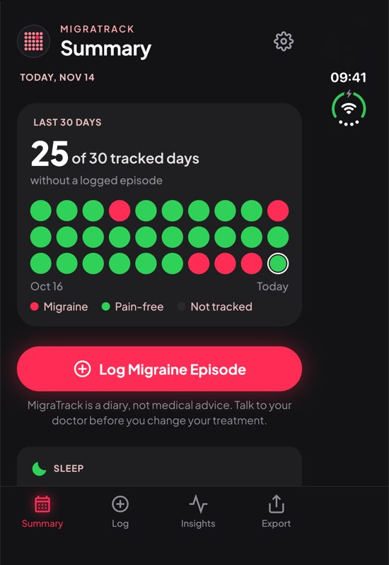 | 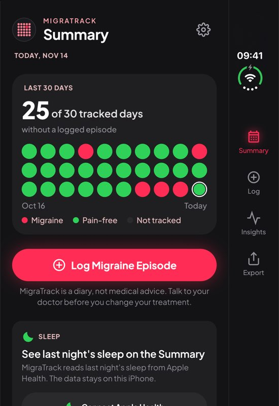 |
| Insights calendar, outer display | 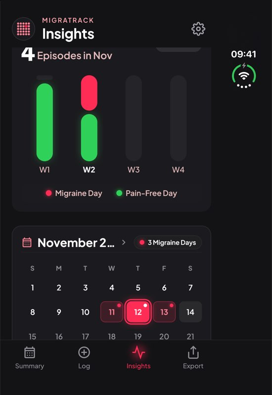 | 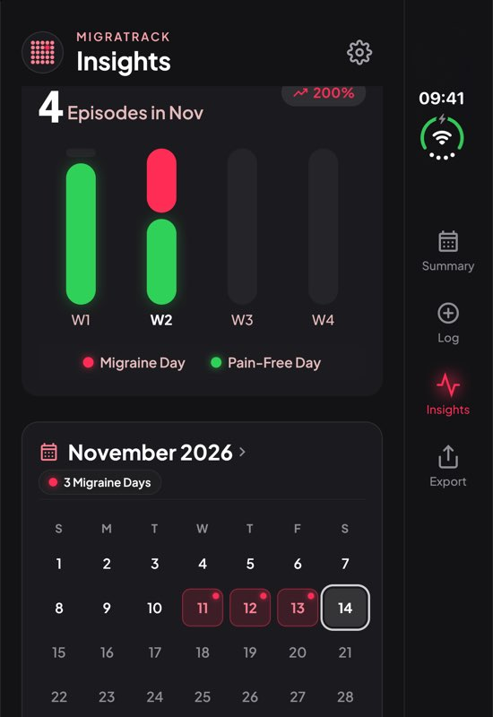 |

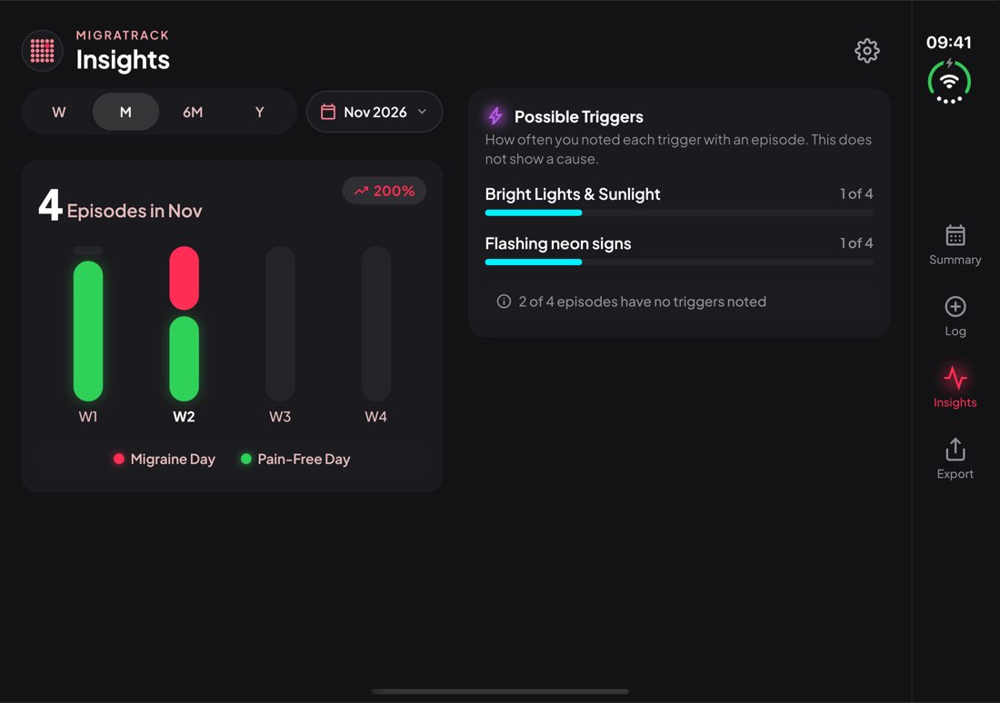

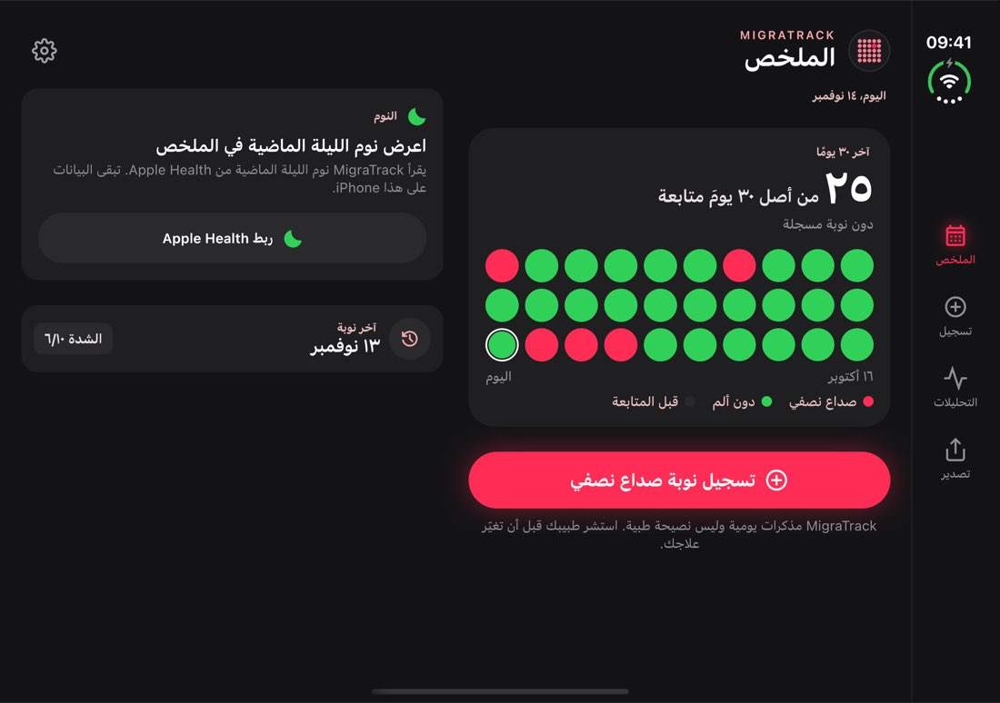

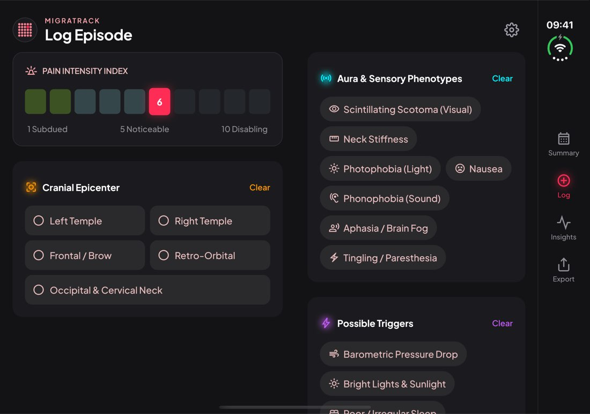

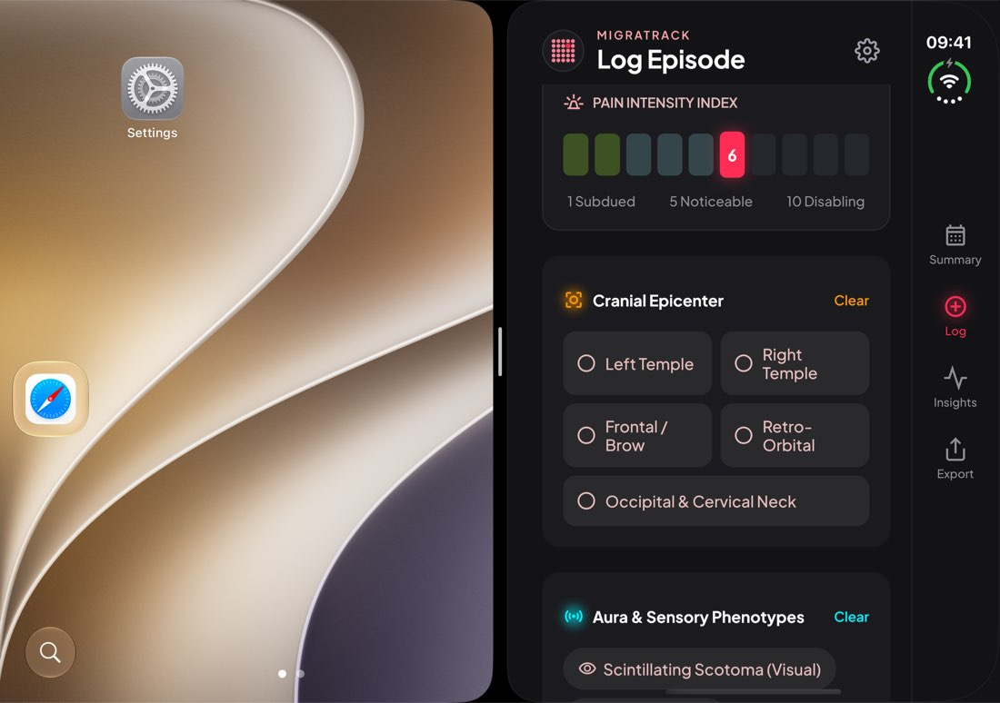

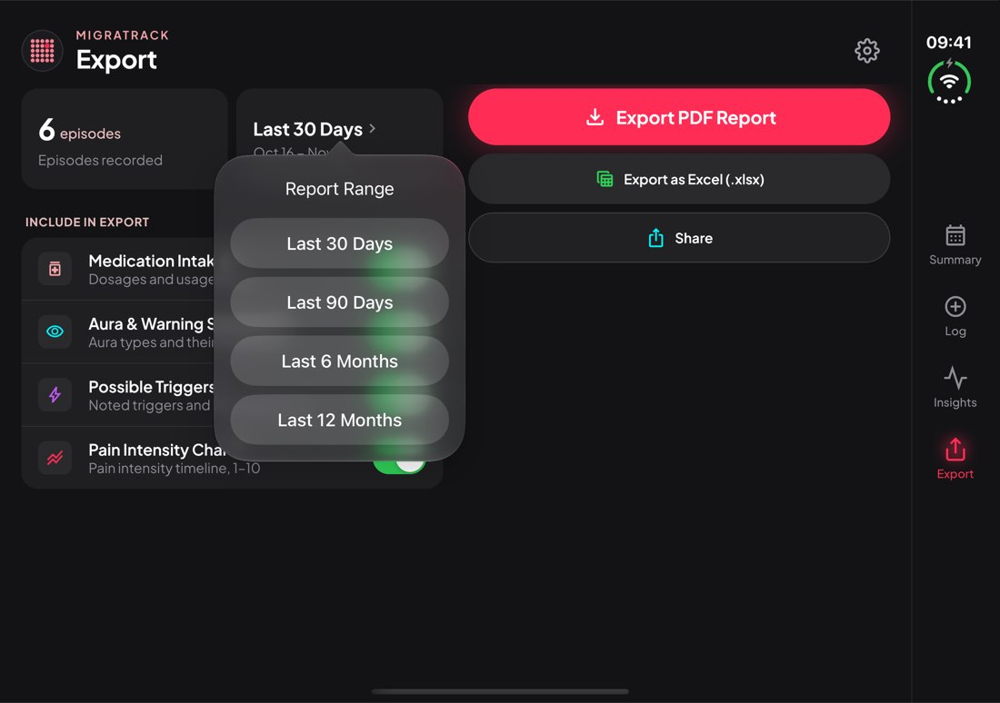

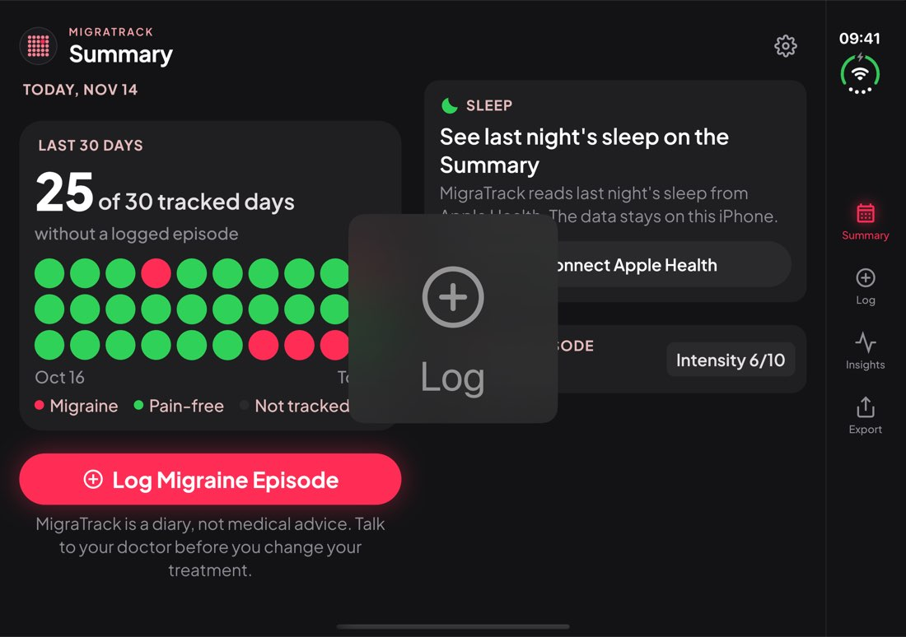

What was tested after the change, on the iPhone Duo simulator (iOS 27.1) and on iPhone 17:

- Outer display, portrait and landscape: rail under the status bar in portrait, bottom tab bar in landscape. English and Arabic.
- Inner display, landscape: two panes on Summary, Log Episode, Insights, Export, and Settings. English and Arabic.
- Partly folded: the pane gap follows the fold (455 to 496 pt).
- Split View with Safari, app on the right: rail under the status bar, one pane.
- Report range sheet: a popover that points at the range tile.
- Large Content Viewer at the accessibility text size: the HUD shows the tab title, and lifting the finger opens the tab.
- Drag of the Export PDF Report button: the drag starts and the app keeps running. A drop into another app was not tested, because the simulator has no app that takes PDF files.
- iPhone 17 in landscape: one column, bottom tab bar. The Welcome screen scrolls to Get Started.
- `./gradlew check --rerun-tasks`: all tests pass. `FoldLayoutTest` covers the pane split and the single-column move at the fold.

Compose UI tests (`org.jetbrains.compose.ui:ui-test`) cover D1, D2, D3, and D9. Each test fails on the code before the change:

- `TabFrameTest`: the rail stays under the status bar column in Arabic, the outer display shows the rail, and an iPhone in landscape keeps the bar at the bottom.
- `CalendarHeaderTest`: at 342 pt and the largest text scale of the app (1.35), the month title gets the width it needs. Before the change it needed 212 px and got 110 px.

## Overview

| ID | Proposal | Size | Risk | When | Status |
|---|---|---|---|---|---|
| D1 | Keep the tab rail under the status bar in right-to-left languages | S | Low | Before 1.0 | Done |
| D2 | Make the narrow outer display a test size and fix the cut calendar title | S | Low | Before 1.0 | Done |
| D3 | Vertical tab bar under the status bar on the outer display | S | Low | Before the Duo screenshots | Done |
| D4 | Two-column layouts on the inner display | L | Medium | Before the Duo screenshots | Done |
| D5 | iPhone Duo screenshots and the product page badge | S | Low | Required from April 2027 | Script and docs done, store images at release |
| D6 | Keep controls off the fold in the partially folded pose | M | Medium | Later | Done |
| D7 | Anchor action sheets and the share sheet to their control | M | Low | Later | Done |
| D8 | Drag the report into another app in Split View | M | Low | Later | Done, drop not tested |
| D9 | Landscape on the outer display | S | Low | Later, optional | Done |
| D10 | System tab bar and navigation bar instead of custom bars | L | High | Decision, not for 1.x | Not done |
| D11 | Large Content Viewer for the tab items | M | Low | Later | Done |
| D12 | Sidebar instead of the tab rail on the inner display | M | Low | Not recommended | Not done |

Size: S is up to one day, M is two to four days, L is one week or more. "Before the Duo screenshots" means before D5.

## Proposals

### D1. Keep the tab rail under the status bar in right-to-left languages

**Apple.** The Prepare page says that with the iOS 27.1 SDK, toolbars and tab bars appear "vertically below the status bar". The status bar of iPhone Duo is on the physical right edge in every language. The Arabic screenshots show this.

**MigraTrack now.** `MainScaffold` puts the `TabRail` at `Alignment.CenterEnd` and pads the `NavHost` at the end edge. In a right-to-left language, the end edge is the left edge. The rail moves to the left. `contentColumn()` still keeps the content out of the status bar column on the right. The window loses 84 pt on each side, and the right column stays empty.

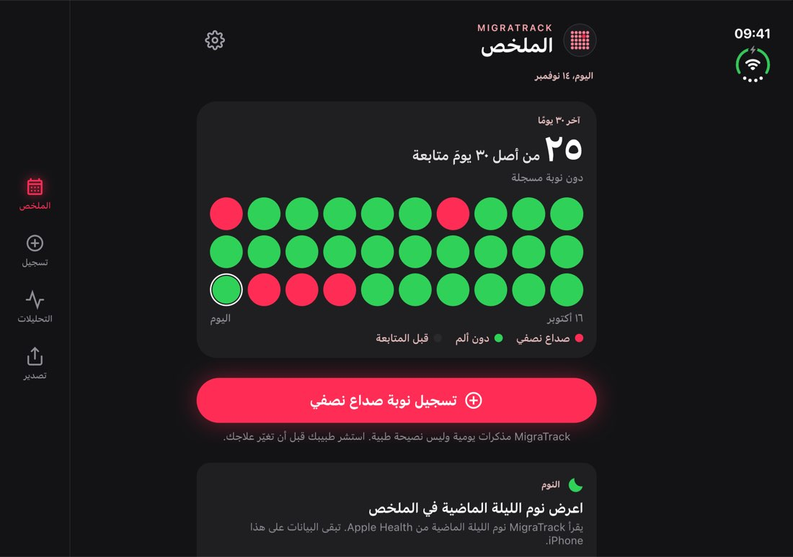

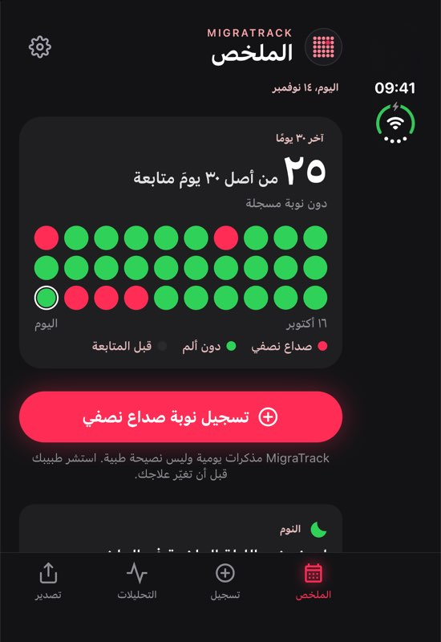

**Change.** Put the rail on the physical right edge in all languages. Use absolute alignment and absolute padding, and read the right inset, not the end inset. Keep the tab order of the language.

**Value.** Users of the three right-to-left languages get the same layout as other users and 84 pt more width.

**Size and risk.** S. Low: the change is in `MainScaffold` only. iPhone layouts do not change, because the rail shows only in windows wider than tall.

**When.** Before 1.0. The inner display opens in landscape, so every right-to-left user with iPhone Duo sees this layout.

**Check first.** The simulator has no system app with a tab bar, so I could not compare with a system app in Arabic. Do this check on a device before you merge.

### D2. Make the narrow outer display a test size and fix the cut calendar title

**Apple.** The Prepare page and tech talk 111461 say that iPhone Duo can show any combination of size classes. Apple tells you to remove device-size checks and to test every display. The HIG Layout page says: "Be prepared for text-size changes."

**MigraTrack now.** On the outer display, the status bar takes about 84 pt on the right. The content column is 382 pt wide. With large text, the Insights calendar title shows "November 2…" in English. The app scales text up to 1.35 times.

**Change.**

1. Let the calendar title wrap, or move the "3 Migraine Days" chip to a second line when the row does not fit.
2. Add the outer display of iPhone Duo to `scripts/l10n-screenshots.sh` and to the localization screenshot check. Then all languages get a check at this width.

**Value.** The calendar shows the full month on the outer display. The next narrow-width defect becomes visible in the screenshot check.

**Size and risk.** S. Low.

**When.** Before 1.0.

### D3. Vertical tab bar under the status bar on the outer display

**Apple.** The HIG page "Designing for iPhone Duo" says that on the outer display, toolbars, tab bars, and navigation controls move to the side. The Prepare page says the same for apps built with the iOS 27.1 SDK. Only one sentence in tech talk 111466 says that a tab bar "stays bottom aligned". The HIG page is newer and more specific, so this proposal follows it.

**MigraTrack now.** The outer display is 466 × 678 pt. The tab bar takes 60 pt at the bottom, plus the home indicator. The status bar column on the right is empty below the battery icon.

**Change.** When the trailing safe area is a vertical status bar column, show the existing `TabRail` in that column. Decide from the safe area insets, not from the device model. Use the same rule as D1 for the right edge.

**Value.** The short outer display gets about 90 pt more height for content. MigraTrack looks like system apps on the outer display.

**Size and risk.** S. Low. The rail exists already. Test the Settings screen and the baseline editors, which hide the bar.

**When.** Before D5, so that the screenshots show the final layout. If Apple changes the system behavior, this proposal is easy to undo.

### D4. Two-column layouts on the inner display

**Apple.**

- HIG "Designing for iPhone Duo": use a compact-width layout for the outer display and a regular-width layout for the inner display. "Keep functionality and the state of elements the same between displays." "Avoid extreme layout changes as people fold the device." In a grid, prefer an even number of columns.
- Tech talk 111466: when space allows, rearrange a vertical stack into two columns. The example is Music.
- HIG Layout: "Keep functionality the same as size classes change." HIG Typography: "Reduce the number of columns when the font size increases."

**MigraTrack now.** On the open device, the window is 951 × 669 pt. The tab rail takes 84 pt. `MaxContentWidth` holds every screen in one 520 pt column. About 170 pt on each side stays empty. On Insights, the chart and the calendar do not fit on one screen, so you scroll between them.

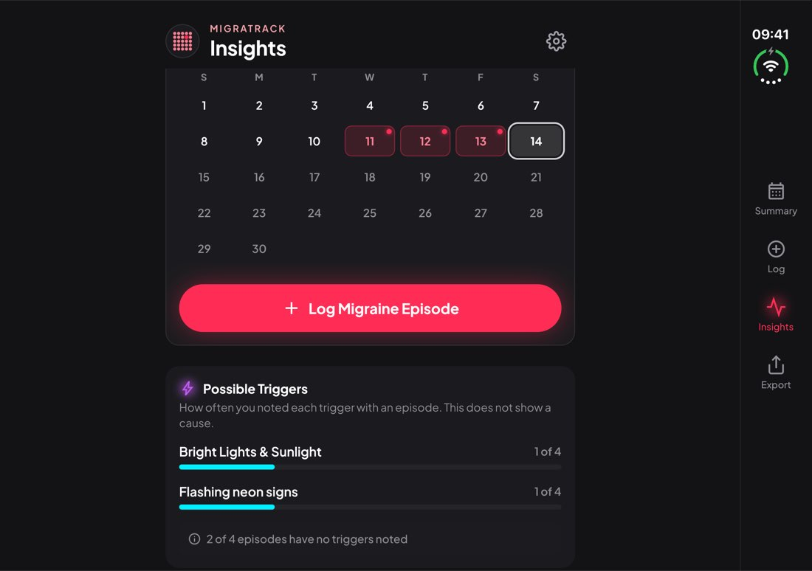

**Change.** Add a two-column layout when the window is at least about 700 pt wide. Keep one column at accessibility text sizes. Keep the order of the content the same, so that a fold or unfold moves blocks but does not change them.

| Screen | Left column | Right column |
|---|---|---|
| Insights (first) | Period control, attack chart, possible triggers | Calendar and the selected day |
| Summary | Last 30 days, Log Migraine Episode button, disclaimer | Sleep, last episode |
| Log Episode | Pain intensity, pain location | Aura and symptoms, medication, triggers, Save |
| Export | Episode count, range, what to include | Export buttons |
| Settings | Profile card | Lists |

The chart in the left column can also show more bars for 6M and Y.

**Value.** On the inner display, users see the chart and the calendar together. Log Episode needs less scrolling during an attack. The content uses the display that people unfold the device for.

**Size and risk.** L for all five screens, M for Insights alone. Medium risk: the screens are Compose layouts with their own state. Use a shared two-column container, so that each screen supplies only its blocks. iPhone layouts do not change below the width limit.

**When.** Before D5. Start with Insights.

### D5. iPhone Duo screenshots and the product page badge

**Apple.**

- News, October 5, 2026: "Starting April 2027, any apps or games submitted will need to include screenshots for iPhone Duo." With them, the product page shows a badge that says the app is optimized for iPhone Duo.
- Screenshot specifications: outer display 1398 × 2034 (portrait) or 2034 × 1398 (landscape), inner display 2007 × 2853 or 2853 × 2007.

**MigraTrack now.** [APP_STORE.md](APP_STORE.md) lists the sizes. It says that the rule applies to "apps built with the iOS 27.1 SDK or later". The news post says "any apps or games submitted". There is no screenshot of iPhone Duo yet.

**Change.**

1. Let `scripts/l10n-screenshots.sh` take a display. `simctl io <udid> screenshot --display <port>` captures one display at a time. The port UUIDs come from `simctl io <udid> enumerate`.
2. Make the store screenshots for both displays after D1, D3, and D4.
3. Correct the scope sentence in APP_STORE.md to the wording of the news post.

**Value.** The product page shows the badge. The first update after April 2027 is not blocked.

**Size and risk.** S. Low.

**When.** Required for the first submission from April 2027. Optional for 1.0. I recommend no Duo screenshots for 1.0 while the inner display shows one narrow column (see D4).

### D6. Keep controls off the fold in the partially folded pose

**Apple.** HIG "Designing for iPhone Duo": "Except for scrollable content, keep interactive elements away from the hinge as much as possible." Tech talk 111463: the fold is a division region. Read it with `reservedRegions(kind: .division)` in SwiftUI or `UIView.reservedRegions(kind:)` in UIKit. System alerts, menus, and sheets move away from the fold.

**MigraTrack now.** The app does not read reserved regions. In the partially folded pose, the layout stays the same. The pain intensity scale and the pain location buttons lie across the middle of the display, where the fold is.

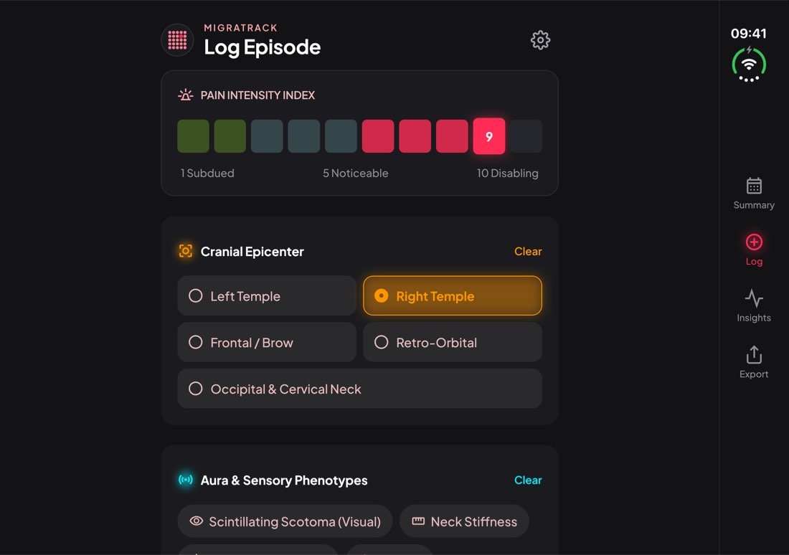

**Change.** Read the division region in the iOS host and pass it to Compose as an inset. With D4, put the column gap on the fold. Without D4, move the single column to one half when the device is partially folded.

**Value.** Users can tap the controls when the device stands like a book or a laptop.

**Size and risk.** M. Medium: Compose Multiplatform has no API for reserved regions, so this needs a small UIKit bridge. The simulator does not draw the fold, so test on a device.

**When.** Later. D4 solves most of it.

### D7. Anchor action sheets and the share sheet to their control

**Apple.** The Prepare page tells you to remove `userInterfaceIdiom` checks. The system moves action sheets, popovers, and menus for each pose.

**MigraTrack now.** `anchorPopover()` in `UIKitPresenter.kt` returns early unless the device is an iPad. On the open iPhone Duo, the action sheet for the report range and the share sheet for Excel open as popovers in the left half. They do not point to the button that opened them. The app does not crash.

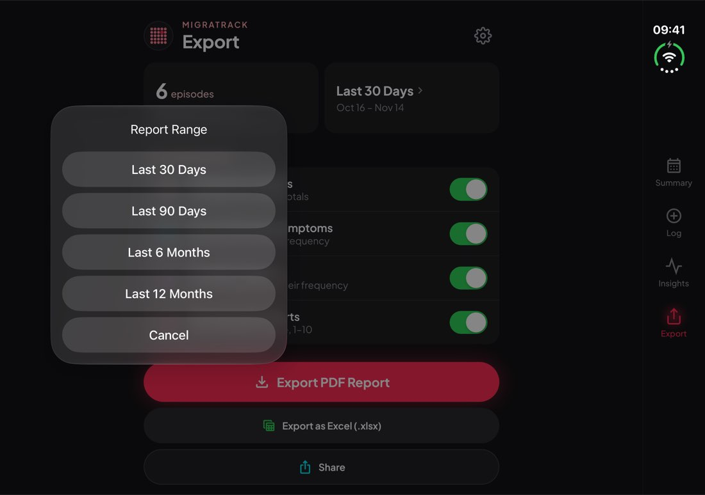

**Change.** Pass the bounds of the tapped Compose element to the dialog service. Set `sourceView` and `sourceRect` on every device, and remove the idiom check. Check the iPhone layout again, because the current comment says that an anchored action sheet becomes a popover on iPhone since iOS 26.

**Value.** On the inner display, the sheet opens next to the control that the user tapped.

**Size and risk.** M. Low. The change is in the dialog service and its call sites.

**When.** Later.

### D8. Drag the report into another app in Split View

**Apple.** Tech talk 111464: all apps take part in side-by-side multitasking on the inner display. The HIG Drag and drop page applies to this layout.

**MigraTrack now.** Split View works. The app keeps the form state and shows the bottom tab bar in the narrow half. The report can leave the app only through the share sheet.

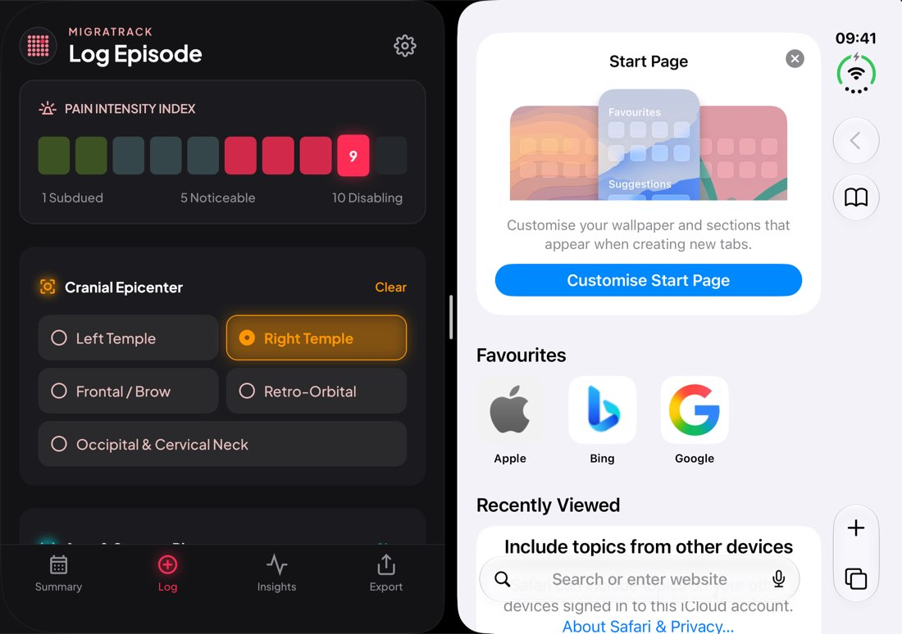

**Change.** Let the user drag the PDF report from the Export screen into Mail, Files, or Notes in the other half.

**Value.** Users can send the report to the doctor with one gesture while they write the message.

**Size and risk.** M. Low. It needs a `UIDragInteraction` bridge from Compose.

**When.** Later, optional.

### D9. Landscape on the outer display

**Apple.** Tech talk 111461: the outer display honors the supported orientations like other iPhones. The talk recommends landscape because people can stand the device like a tent. The inner display does not honor them.

**MigraTrack now.** `Info.plist` allows portrait only. The outer display stays in portrait. On the inner display, the app rotated to portrait and back without problems, and it kept the scroll position.

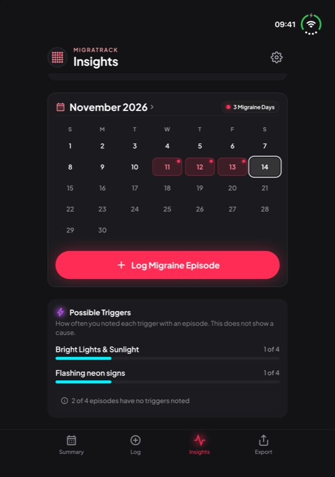

**Change.** Allow landscape on the outer display. The rail already handles windows that are wider than tall.

**Value.** Low for a diary. The main use is to read Insights with the device on a table.

**Size and risk.** S to build, M to test on every iPhone, because the key also applies to other iPhones.

**When.** Later, optional.

### D10. System tab bar and navigation bar instead of custom bars

**Apple.** Tech talk 111462: "In UIKit, prefer using UINavigationController and UITabBarController, which manage their own bars." Only system bars get the vertical layout, the overflow menu, and the fold avoidance automatically. Apple does not forbid custom bars.

**MigraTrack now.** Compose draws the tab bar, the header, the back button, and the Settings button. PR #17 and D1 and D3 copy the system layout by hand.

**Change.** Host each tab in a `UITabBarController` with a `UINavigationController`, and keep Compose for the content.

**Value.** Future iPhone Duo behavior comes from the system without app changes.

**Size and risk.** L. High: it changes the navigation, the back stack, and the state restoration of the whole app.

**When.** Not for 1.x. Decide again if Apple changes the bars again.

### D11. Large Content Viewer for the tab items

**Apple.** HIG Typography: "Make sure your app's layout adapts to all font sizes." System tab bars do not scale their labels. They show the Large Content Viewer when the user holds a tab at accessibility text sizes.

**MigraTrack now.** `TabItem` uses `WithoutFontScaling`. The labels stay small in the bottom bar and in the rail, and there is no Large Content Viewer.

**Change.** Add `UILargeContentViewerInteraction` to the tab items through the iOS host.

**Value.** Users with large text can read the tab names.

**Size and risk.** M. Low. This is not specific to iPhone Duo, but the rail on the inner display makes the small labels more visible.

**When.** Later.

### D12. Sidebar instead of the tab rail on the inner display

**Apple.** Tech talk 111461: an app can opt in to show the tab bar as a sidebar on the inner display. Tech talk 111466 uses Health as the example and says that this "isn't for every app". HIG Sidebars: "Consider using a tab bar first."

**MigraTrack now.** Four tabs with no second level. The rail shows all of them.

**Change.** None. A sidebar adds width and no new navigation level.

**When.** Not recommended.

## What already conforms

These checks passed. They need no change.

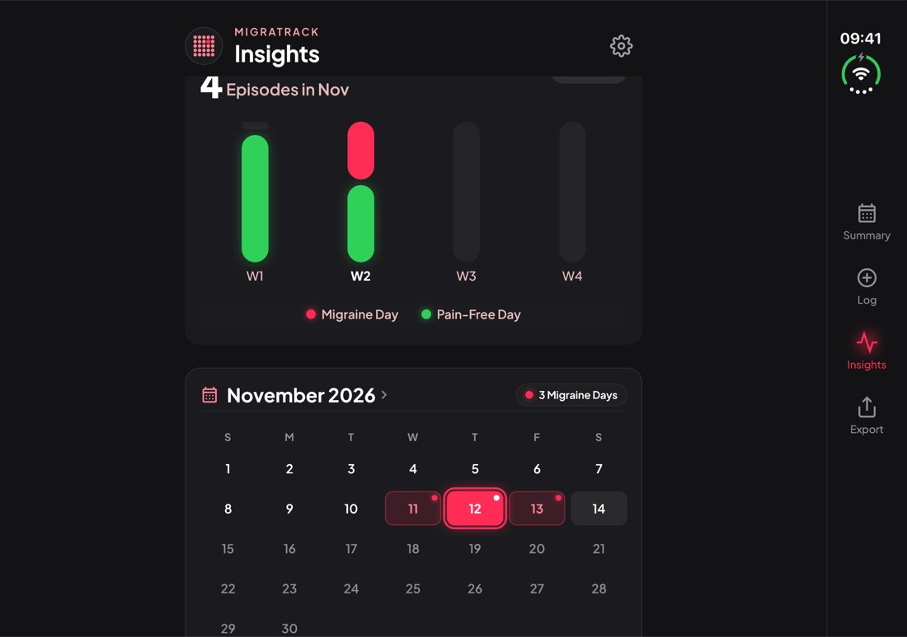

| Area | Apple guidance | Result in MigraTrack |
|---|---|---|
| State across fold and unfold | "Keep functionality and the state of elements the same between displays" (HIG) | Insights kept the tab, the open calendar, the selected day, and the scroll position when unfolded. Log Episode kept intensity 9 and "Right Temple" through the partially folded pose, Split View, and closing. Compose keeps one view controller, so the size change does not recreate it. |
| Inner display in portrait | "The exception is the inner display in portrait", which keeps horizontal bars (HIG) | The app rotates to 669 × 951 pt and shows the bottom tab bar. |
| Multitasking | All apps take part in Split View (tech talk 111464). `UIRequiresFullScreen` is deprecated (documentation) | Split View with Safari works. `Info.plist` has no `UIRequiresFullScreen`. |
| Screen assumptions | Remove `UIScreen.main`, orientation, and device-size checks (Prepare page) | The code has none. `MainScaffold` compares the width and height of the window, which the Prepare page allows. The only idiom check is in D7. |
| System sheets | Use system sheets, alerts, and menus to get pose behavior (tech talk 111466) | Quick Look, the share sheet, action sheets, and alerts are UIKit. On both displays they place themselves around the status bar and the fold. |
| Status bar column | Keep interactive content in the safe area. Insets on opposite sides are not equal (tech talk 111461) | `contentColumn()` reads the horizontal `safeDrawing` insets on each side. No content goes under the status bar. |
| Multiple windows | iPhone Duo can show several windows of an app on the inner display (tech talk 111464) | The app declares no scene manifest, so it has one window. This is correct for 1.0: one diary, one database, no reason for a second window. |
| Apple Watch | No iPhone Duo guidance for watch apps was found | No change. |

## PR #17 against the guidelines

Most of PR #17 follows Apple: it uses safe area insets, it decides from the window size and not from the device, and it keeps iPhone layouts unchanged. Three points go against the guidelines:

1. The rail is on the wrong edge in right-to-left languages (D1).
2. The outer display keeps a bottom tab bar, but the HIG moves tab bars to the side there (D3).
3. `MaxContentWidth` is one fixed width for every window. The HIG asks for a regular-width layout on the inner display and warns against fixed widths. The cap is correct for reading width, but it is not a regular-width layout (D4).

The idiom check in `anchorPopover()` is older than PR #17, but it is also against the Prepare page (D7).

## Apple sources

Read on November 14, 2026. The HIG and documentation pages render in the browser. Their text comes from the DocC JSON at `https://developer.apple.com/tutorials/data/<path>.json`.

| Source | Date | Requirements and recommendations used here |
|---|---|---|
| [Three steps to make your app shine on iPhone Duo](https://developer.apple.com/iphone-duo/prepare/) | No date | Behavior by SDK: iOS 26 SDK centered with empty space, iOS 27 SDK fills most of the display, iOS 27.1 SDK fills it with vertical bars below the status bar. Remove `UIScreen.main`, orientation, idiom, and device-size checks. Read the size on every layout pass. Test with Device Hub. |
| [Get ready for iPhone Duo](https://developer.apple.com/iphone-duo/) | No date | Index of the tech talks, labs, forums, and design kits. |
| [Prepare and submit your apps for iPhone Duo](https://developer.apple.com/news/?id=kkphp5qo) | October 5, 2026 | On sale October 23, 2026. Recompile with Xcode 27.1. Test all poses in Device Hub. Duo screenshots required from April 2027. Badge on the product page. |
| [Designing for iPhone Duo](https://developer.apple.com/design/human-interface-guidelines/designing-for-iphone-duo) (HIG) | New page, September 9, 2026 | Build to resize. Compact width outside, regular width inside. Same functions and state on both displays. No extreme changes on fold. Even grid columns. Bars on the side, except on the inner display in portrait. Interactive elements away from the hinge. |
| [Preparing your app for iPhone Duo](https://developer.apple.com/documentation/technologyoverviews/preparing-your-app-for-iphone-duo) | No date | Build with the latest Xcode. Test closed, open, and partially folded. Prefer system containers. Optimize bars for vertical presentation. Items with a custom view do not become vertical. Reserved regions for the fold and the cameras. |
| [Prepare your app for iPhone Duo](https://developer.apple.com/videos/play/tech-talks/111461/) (tech talk) | No date shown | Size classes: outer compact × regular, inner regular × regular. "The inner display doesn't honor your supported interface orientations." Sidebar is opt-in. Asymmetric safe areas. Test Split View on both sides. |
| [Raise the bar with iPhone Duo](https://developer.apple.com/videos/play/tech-talks/111462/) (tech talk) | No date shown | Prefer `UINavigationController` and `UITabBarController`. Vertical bars have a fixed width. Give every item a title. Overflow and compression behavior. |
| [Strike a pose with adaptive layouts on iPhone Duo](https://developer.apple.com/videos/play/tech-talks/111463/) (tech talk) | No date shown | Division and occlusion regions. Scrolling content does not move for the fold. `ArrangementView` and `UIArrangementViewController`. |
| [Leverage multiple displays and scenes on iPhone Duo](https://developer.apple.com/videos/play/tech-talks/111464/) (tech talk) | No date shown | Hinge state API. All apps take part in side-by-side multitasking. Multiple windows on the inner display only. |
| [Design for iPhone Duo](https://developer.apple.com/videos/play/tech-talks/111466/) (tech talk) | No date shown | Two size classes to design for. Controls along the side. Two columns where space allows. Tab bar as sidebar is "not for every app". Sheets and fold avoidance. |
| [Layout](https://developer.apple.com/design/human-interface-guidelines/layout) (HIG) | Updated September 9, 2026 | Layout by size class, not device or orientation. Same functions across size classes. Readable width. Prepare for text-size changes. |
| [Tab bars](https://developer.apple.com/design/human-interface-guidelines/tab-bars) and [Sidebars](https://developer.apple.com/design/human-interface-guidelines/sidebars) (HIG) | Updated June 8, 2026 | Tab bar for navigation. Consider a tab bar first. No iPhone Duo section. |
| [Typography](https://developer.apple.com/design/human-interface-guidelines/typography) (HIG) | Updated December 16, 2025 | Adapt the layout to all font sizes. Fewer columns at large sizes. Minimal truncation. |
| [Multitasking](https://developer.apple.com/design/human-interface-guidelines/multitasking) (HIG) | Updated June 9, 2025 | Save and restore context. No iPhone Duo section. |
| [UIRequiresFullScreen](https://developer.apple.com/documentation/bundleresources/information-property-list/uirequiresfullscreen) | Deprecated in iOS 26 | Support resizing and remove the key. Tech talk 111461 says that iPhone Duo still honors it, but the app resizes anyway. |
| [Screenshot specifications](https://developer.apple.com/help/app-store-connect/reference/app-information/screenshot-specifications) | No date | Outer 1398 × 2034, inner 2007 × 2853, and the landscape sizes. |
| [App Review Guidelines](https://developer.apple.com/app-store/review/guidelines/) | Updated October 16, 2026 | No rule for iPhone Duo or foldable devices was found. Section 4 was not read in full. |

**Contradictions in the sources.** Tech talk 111466 says that a tab bar "stays bottom aligned". The HIG page and the Prepare page put tab bars on the side of the outer display. Tech talk 111461 says once that iPhone Duo "respects your supported interface orientations", and once that the inner display does not. The simulator showed the second: the app rotated on the inner display.

**Not found.** No Apple page gives point sizes for the displays, a rule for portrait-only apps, or a rule for scroll position on fold. The point sizes in this document come from the simulator: outer 466 × 678 pt, inner 951 × 669 pt.

## Test record

| Check | Closed | Open | Result |
|---|---|---|---|
| Welcome and onboarding | Yes | No | Closed: correct, content stays left of the status bar. Open: not tested in this session. PR #17 has screenshots. |
| Summary, Log Episode, Insights, Export, Settings in English, Arabic, German | Yes | Yes | Correct, except D1 and D2. The German screens that I checked fit on both displays. |
| Insights calendar and day selection | Yes | Yes | Correct, except D2. |
| Report range action sheet | Yes | Yes | Correct, see D7. |
| Export PDF in Quick Look, share from Quick Look | Yes | Yes | Correct. |
| Export Excel share sheet | No | Yes | Correct, see D7. |
| Month picker sheet | No | No | Not tested. |
| Legal documents | No | No | Not tested in this session. The Legal screen uses the same `Page` component. |
| Unfold with Insights open | | | State kept. |
| Inner display portrait and back | | | Rotates, state kept. |
| Partially folded pose | | | No layout change, see D6. |
| Split View with Safari (app on the left) | | | Correct. The right side was not tested. |
| Close with Log Episode filled in | | | State kept. |

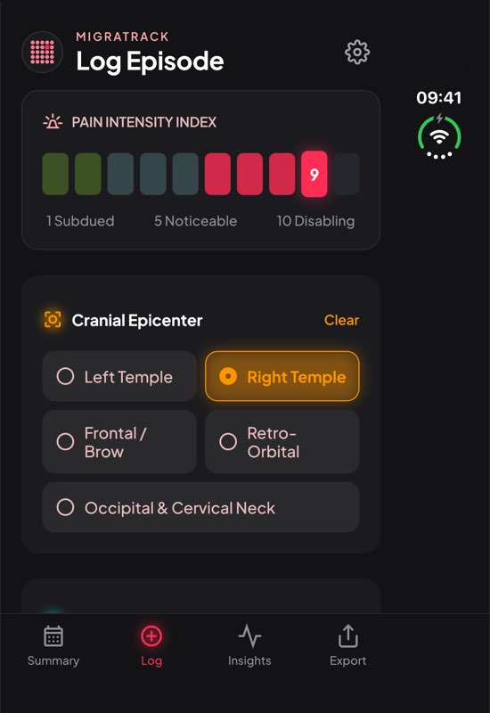
